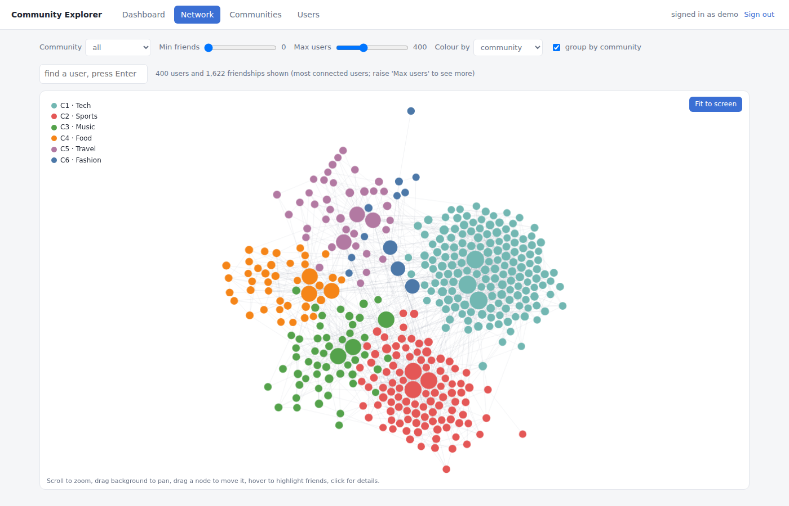
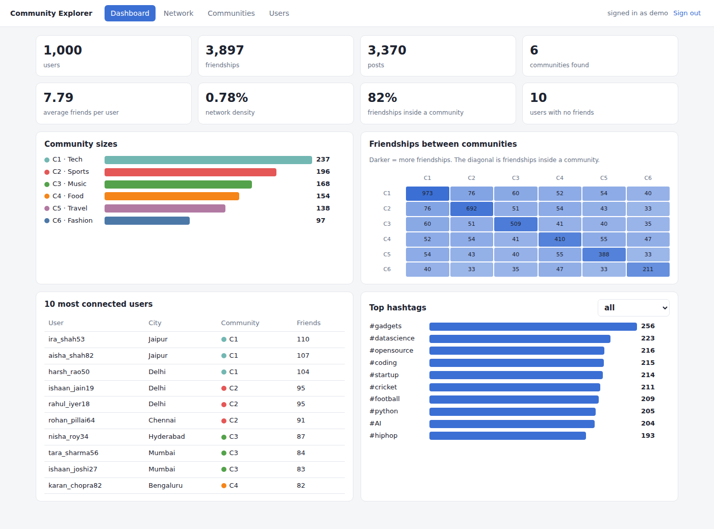
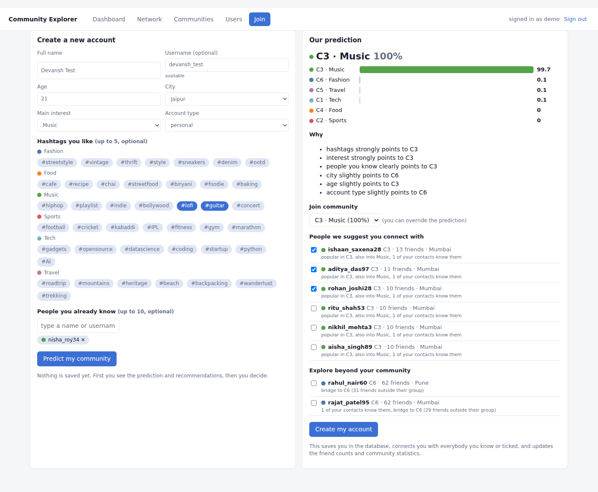
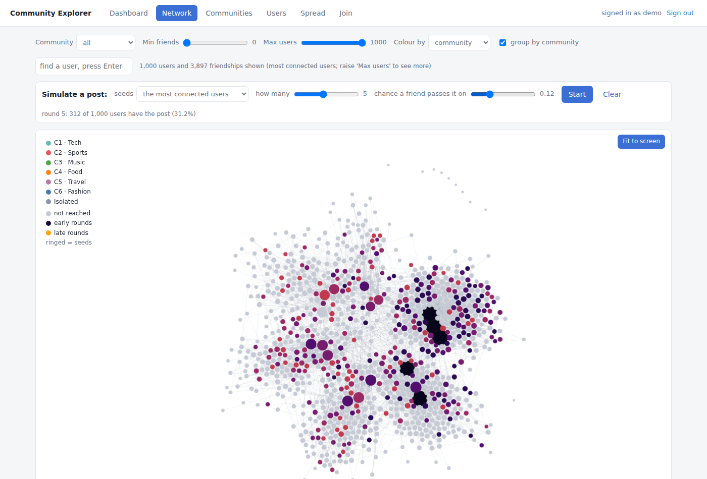

# Social Network Community & Information-Flow Visualisation

[](../../actions/workflows/tests.yml)

An end-to-end graph project: messy social-network data goes in, and an interactive website comes out. It cleans the data, finds communities, recommends people to new users, and simulates how a post spreads.

> **Note:** the dataset is **synthetic** (generated by `stage1_create_dataset.py`, fixed seed). No real users or personal data. Results such as the 96% community match are partly because the generator builds interest groups into the data, so treat them as a validation of the method, not a claim about real platforms.

| Network view | Dashboard |
|---|---|
|  |  |
| **Join: predict community and recommend people** | **Spread simulation** |
|  |  |

## What it does
- **Data cleaning (pandas):** finds and fixes 17 planted error types (duplicates, self-friendships, ghost users, bad dates, impossible ages).
- **Graph analysis (NetworkX):** degree, density, isolated/pendent users, complement graph, diameter, PageRank, betweenness.
- **Communities (Louvain):** 6 communities, modularity 0.62, purity 0.96, NMI 0.90 against a hidden answer key.
- **Website (Flask + D3):** force-directed network with zoom, drag, hover, search and filters.
- **New users (Naive Bayes):** predicts a community, explains why, recommends people, and saves the user to SQLite. Leave-one-out accuracy is 96.4%.
- **Information flow (independent cascade):** compares seeding strategies for viral marketing and blocking strategies for fake news.

## Quick start
```bash
git clone https://github.com/Devansh-Agarwal47/social-network-community-visualisation.git
cd social-network-community-visualisation
pip install -r requirements.txt
python stage6_api.py          # opens http://127.0.0.1:5000
```
Sign in with `demo` / `graph123` (a demo gate, not real security).

Generated data and the database are already included. To rebuild everything from scratch, run the scripts in order:
```bash
python stage1_create_dataset.py   # synthetic raw CSVs + hidden answer key
python stage1_explore_data.py     # data profile
python stage2_clean_data.py       # clean tables
python stage3_graph_analysis.py   # graph metrics
python stage4_communities.py      # Louvain communities
python stage5_database.py         # builds data/social.db (removes users added through the website)
python stage9_recommender.py      # recommender evaluation
python stage10_spread.py          # spread experiments
```

## Tests
```bash
python stage6_test_api.py     # API, database and validation checks
```
About 144 automated checks run across the stage scripts. CI runs the API tests and the recommender on every push.

## Files
| File | Purpose |
|---|---|
| `stage1_*.py` | synthetic data + profiling |
| `stage2_clean_data.py` | cleaning |
| `stage3_graph_analysis.py`, `stage4_communities.py` | graph metrics, communities |
| `stage5_database.py` | SQLite database |
| `stage6_api.py`, `stage7_frontend.py` | Flask API, website (frontend is generated into `frontend/`) |
| `stage9_recommender.py` | prediction and recommendation |
| `stage10_spread.py` | spread simulation |
| `REPORT.md`, `DATA_DICTIONARY.md`, `docs/BUILD_LOG.md` | full report, column meanings, build log |

There is no `stage8` file. That roadmap step (connect frontend to backend with `fetch()`) lives inside `stage7_frontend.py` and `stage6_api.py`.

## Tech
Python, pandas, NumPy, NetworkX, Matplotlib, SQLite, Flask, D3.js (bundled).

## License
MIT. See [LICENSE](LICENSE).
